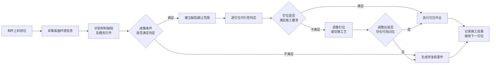
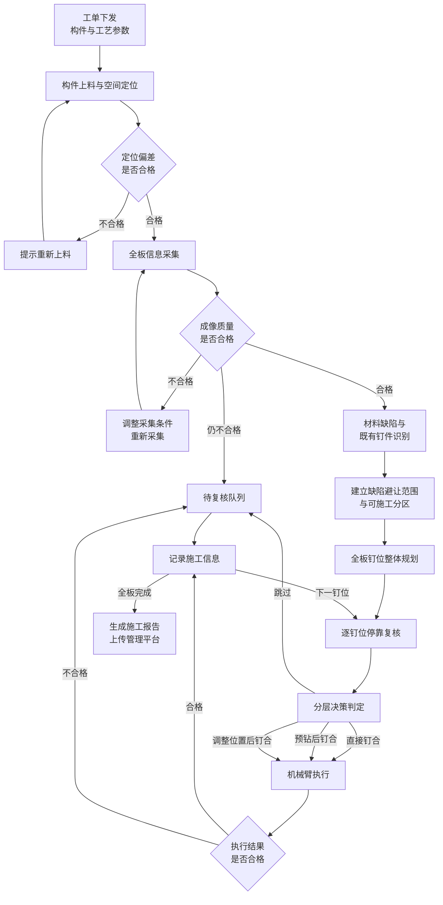

# 预制竹木构件智能打钉机器人场景技术栈

## 1. 板面缺陷随机分布，按图纸固定钉位打钉易造成连接承载力不可控，存在结构安全与返修风险

### 整体技术方案

本方案面向预制竹木构件的墙体与楼板钉合工位，通过智能打钉机器人平台对上料构件的板面状态进行自动化检查，实现对钉位与材料缺陷之间冲突风险的识别与规避。

机械臂按照工单下发的图纸钉位序列运行，本方案负责板面感知、钉位判定与执行监控。构件上料到位后，系统通过搭载的视觉感知设备采集板面信息，对木节、裂缝、腐朽、虫洞等材料缺陷以及既有钉件等固定目标进行识别，并结合构件基材类型与纹理方向，分析每一颗设计钉位与周边缺陷之间的空间关系和材料状态。

由于木材与竹材属于天然材料，缺陷在板面上的分布随批次、部位不断变化，传统按图纸固定钉位施工或依靠工人目视避让的方式，难以保证每颗钉的连接性能一致。因此，本方案通过建立设计钉位与实际板面状态之间的空间关联关系，实现对钉位可行性的逐点动态判定。

当发现钉位落在材料缺陷范围内、与既有钉件距离过近、所处位置不满足规范间距要求，或板面成像条件不足以支撑判定等情况时，系统能够自动调整钉位、切换施工工艺或跳过该点位并生成待复核事件，辅助现场人员及时干预。本系统是钉位决策与执行设备，不替代机械臂本体的碰撞检测、安全光栅、急停回路及法定安全装置。

---

### 1.1 系统目标与适用边界

本系统的目标是把「按图纸打钉」升级为「按板面实际状态打钉」，使每一颗钉的位置选择都有明确依据，并且施工过程可追溯。

系统需要解决的现场问题包括：

- 设计钉位与材料缺陷发生空间冲突，导致握钉力不足或连接失效；
- 缺陷避让缺乏统一标准，不同班组、不同工人处理方式不一致；
- 竹材与硬质基材顺纹钉入时发生劈裂，且事后不可修复；
- 多层叠合返工时看不见下层已有钉件，造成钉件碰撞与工具损坏；
- 上下层板件搭接范围不足，钉件只咬合单层，节点承载力不达标；
- 视觉识别位置传递到机械臂后出现偏差，实际落钉点与判定点不一致；
- 施工完成后无钉位级记录，出现质量问题无法定位到具体钉位；
- 成像条件不佳时系统仍强行给出结论，把「没看清」当成「没问题」。

适用边界说明：

- 本系统为钉位决策与执行设备，不替代机械臂本体安全装置与法定防护设施；
- 首版不做树种自动识别与材料力学性能反演，基材类型与纹理方向由工单参数下发；
- 缺陷类别与严重程度分级标准由甲方工艺文件配置，可按产线需求增减；
- 文中涉及的各项判定条件均为初始设定，须结合实际构件尺寸、钉件规格与基材特性，经现场标定确认后固化；
- 智能分析模型参与决策的范围限定为策略建议、理由生成与规则冲突提示，不参与钉位坐标计算，也不承担最终放行职责。

---

### 1.2 构件上料与空间定位技术方案

构件到达钉合工位后，系统首先需要确定构件在机械臂工作空间中的实际位置，这是后续所有钉位判定的坐标基准。

构件通过机械定位与压紧机构完成粗定位，残余偏差由视觉感知补偿。系统采集构件轮廓与板面标志信息，建立板面坐标系与机械臂坐标系之间的空间对应关系。

主要定位内容包括：

- 构件在工位上的实际位置与角度偏差；
- 板面轮廓边界与有效作业范围；
- 视觉设备与机械臂之间的空间对应关系；
- 板面平整度与厚度状态；
- 多层叠合时上下层板件的重合范围。

所有缺陷位置与钉位位置统一换算到板面实际尺寸坐标中参与判定，不使用图像像素位置直接进行距离比较，避免成像透视与尺度差异带来的偏差。当定位偏差超出允许范围时，系统判定上料异常，提示重新上料而不进入后续作业。

通过建立稳定的空间基准，使视觉判定结果能够准确传递到机械臂执行环节。

---

### 1.3 现场信息采集与成像质量控制技术方案

板面缺陷判定完全依赖成像质量，因此系统在进入缺陷识别之前，先对采集到的现场信息做质量确认。

系统对采集画面进行状态评估，主要评估内容包括：

- 画面清晰程度是否满足缺陷判定要求；
- 明暗与曝光状态是否正常，是否存在过暗或过曝区域；
- 缺陷目标在画面中的成像尺寸是否足够；
- 缺陷区域是否被画面边界截断；
- 采集时机械臂是否已充分静止；
- 板面反光是否影响纹理与缺陷的可辨识度。

只有通过质量确认的画面才允许进入缺陷终判。当质量条件不满足时，系统执行补光调整、静止等待、靠近复检或移动视场重采等动作；仍不可判定时，系统返回「待确认」状态并生成人工复核记录，**不会因为看不清而默认判定为板面无缺陷**。

通过成像质量控制，使系统在复杂现场光照与材料条件下保持判定结论的可靠性。

---

### 1.4 板面缺陷自动识别技术方案

系统通过视觉感知能力对上料构件板面进行主动采集，实现对影响钉合质量的材料状态的自动识别。

系统主要针对可能造成连接性能下降的目标进行感知，包括：

- 活节与死节等木节类缺陷；
- 板面裂缝；
- 腐朽区域；
- 虫洞；
- 既有钉件的外露与锈蚀钉帽；
- 木纹方向与基材类型状态。

系统在识别缺陷类别的同时，输出缺陷在板面上的实际范围与严重程度分级，为后续避让范围与施工工艺选择提供基础。

同时，系统可结合不同构件类型与产线工艺特点，对墙体板、楼板、节点区域等重点部位设置差异化的检查规则，提高复杂材料条件下的感知适应能力。

---

### 1.5 缺陷避让范围建立技术方案

缺陷对连接性能的影响并不局限于缺陷本身的轮廓范围，其周边区域的材料强度同样会受到削弱，因此系统需要在识别结果的基础上建立安全避让范围。

系统结合缺陷类别、严重程度与基材特性，在板面上建立分级的可施工性分区：

- 缺陷本体范围，禁止落钉；
- 缺陷周边影响范围，落钉需要调整施工工艺；
- 板面边缘范围，按规范边距要求预留；
- 既有钉件周边范围，禁止落钉；
- 多层叠合时的有效搭接范围之外，禁止落钉。

避让范围的取值依据来自组内已完成的紧固件承载力试验数据，通过承载力折减程度与钉件到缺陷距离之间的关系反算得到，而非直接采用经验数值。该取值是系统最关键的可标定参数，投产前须按实际钉件规格与基材类型重新标定。

对于缺陷分布密集、按分区方式无可用点位的板面，系统支持切换为连续风险评估模式，在可施工性与位置偏移之间做权衡，避免出现整板无法施工的情况。

---

### 1.6 钉位位置优化技术方案

在明确可施工范围之后，系统需要为每一颗不可直接施工的设计钉位确定替代位置。

系统对每颗设计钉位逐点判定，并按以下原则确定最终位置：

- 位于可施工范围内的钉位，保持原设计位置不变；
- 位于避让范围内的钉位，在可施工范围内寻找最接近原设计位置的可用点位；
- 位置调整量超出记录阈值的钉位，标记为换位并记录设计位置与实际位置；
- 调整后仍无可用点位的钉位，判定为跳过并转入人工复核；
- 位置调整后须重新校核与相邻钉位、板面边缘之间的间距要求。

系统在秒级内完成全板钉位的整体规划，随后机械臂逐点位移动，在每个钉位上方短暂停靠，结合局部复检结果做最终确认后才触发施工动作。

通过「全板整体规划 + 逐钉位停靠复核」的两级方式，系统实现由「按图纸执行钉位」到「按板面状态确定钉位」的能力提升。

---

### 1.7 规范符合性校核技术方案

钉位调整不能只考虑避开缺陷，还必须满足木结构连接的设计规范要求，否则位置虽然避开了缺陷，连接构造却不合规。

系统内置木结构设计规范与紧固件试验标准知识库，已入库标准包括欧洲木结构设计规范 Eurocode 5（EN 1995-1-1）、紧固件拔出承载力试验标准 EN 1382、承重钉连接试验方法 EN 1380、紧固件连接力学性能测定标准 EN 26891、结构木材特征值测定标准 EN 384，以及国内木结构设计标准 GB/T 50005。系统在此基础上对每颗钉位进行符合性校核：

- 钉件之间的顺纹与横纹最小间距要求；
- 钉件到板面端部与边缘的最小距离要求；
- 不同基材密度条件下的预钻要求；
- 预钻孔径与钉件直径的比例限制；
- 纹理方向对间距取值的影响。

系统对每一条判定结论保留可核查的规范依据。当智能分析模型给出的建议与规范强制要求发生冲突，或所引用的规范条目无法在知识库中核实时，系统自动降级为保守处理方式，**不允许模型结论覆盖规范强制要求**。

通过规范知识库与强制校验机制，使每颗钉的决策都能追溯到明确的规范依据，而不是停留在模型输出层面。

---

### 1.8 安全决策判断与施工记录技术方案

系统根据产线工艺要求建立分层决策机制，对每颗钉位的判定结果进行综合分析。

决策按由强到弱的优先级逐层收敛：

- 装配层约束，判断钉位是否位于有效搭接范围内；
- 规范强制约束，判断是否违反间距、边距与既有钉件安全距离要求；
- 材料状态判断，根据缺陷类别与严重程度确定施工工艺；
- 智能分析复核，生成判定理由、风险提示与规范引用。

系统最终对每颗钉位输出四类处理方式之一：直接钉合、预钻后钉合、调整位置后钉合、跳过并转人工复核。多条判定条件同时命中时，系统取最保守的处理方式。

同时系统记录每颗钉位的完整施工信息：

- 钉位编号与所属构件、工位；
- 设计位置、实际执行位置与位置偏移量；
- 处理方式与判定理由；
- 命中的规范条目与材料状态；
- 板面原图与标注图、局部复检图像；
- 执行过程反馈信息；
- 成像质量状态与置信程度；
- 各环节时间记录。

施工记录可导出为施工报告并上传管理平台，支持断网续传与重复事件合并，为后续质量追溯与工艺优化提供依据。

---

### 1.9 机械臂作业执行与过程监控技术方案

判定结果确认后，系统将处理方式转换为机械臂的标准作业动作，并对执行过程进行监控。

系统按处理方式组织作业动作序列，涵盖移动就位、预钻、钉合、退回安全位置以及跳过标记等标准动作。每个动作执行前均校验决策已放行、目标位置在工作空间内、无碰撞风险且安全回路闭合，任一项不满足即转入故障状态并停止取料。

执行过程中系统对以下状态进行监控：

- 钉件实际入板深度是否达到要求；
- 钉合作用力是否处于设定范围；
- 预钻深度是否满足工艺要求；
- 钉仓是否存在空钉与卡钉；
- 钉合完成后局部区域是否出现新增裂缝。

监控发现异常时，系统标记该钉位为不合格并生成告警，避免异常钉位在无记录的情况下流入下道工序。

通过执行过程闭环监控，使系统的能力从「按判定结果动作」提升为「确认施工结果符合要求」。

---

### 1.10 系统整体实现流程

系统整体按「上料定位 — 板面感知 — 钉位判定 — 作业执行 — 记录归档」的顺序运行，全流程无需人工干预，仅在出现待复核事件时需要现场人员处理。

流程各环节的对应关系如下：

| 环节 | 系统动作 | 输出 |
|---|---|---|
| 上料定位 | 建立构件与机械臂之间的空间基准 | 板面坐标系、有效作业范围 |
| 板面感知 | 采集并确认成像质量，识别材料缺陷与既有钉件 | 缺陷类别、范围、严重程度 |
| 钉位判定 | 建立避让范围，规划钉位，逐点分层决策 | 每颗钉的处理方式与实际位置 |
| 作业执行 | 组织标准动作序列并监控执行状态 | 执行反馈、异常告警 |
| 记录归档 | 汇总逐钉施工信息 | 施工报告、待复核清单 |

---

## 2. 系统构成与设备能力要求

系统由感知、决策、执行三部分构成，各部分设备的能力要求与参考型号如下。**参考型号为满足能力要求的可选方案，供技术交流与预算编制参考；最终型号在样机阶段结合现场空间、构件尺寸与工艺验证结果确定，并可按客户既有设备品牌习惯替换为同等级产品。**

### 2.1 视觉感知设备

| 设备 | 能力要求 | 参考型号 |
|---|---|---|
| 面阵视觉采集设备 | 分辨能力需支撑最小缺陷尺寸的判定，单次采集覆盖构件宽度方向 | 海康机器人 MV-CS050-10GC（500 万像素，千兆网口）；巴斯勒 acA2440-35um 同等级 |
| 光学镜头 | 低畸变工业级镜头，视场与工作距离匹配工位空间 | Computar M1614-MP2（16 mm 定焦，C 口，500 万像素级）；同焦段低畸变镜头可替换 |
| 照明设备 | 亮度可调，具备反光抑制能力，适应木材与竹材低对比纹理 | 条形白光 LED 光源两组对射，配线性偏振片；可选环形无影光源 |
| 三维轮廓采集设备 | 用于板面平整度、厚度与搭接状态确认 | 梅卡曼德 Mech-Eye LSR L（大视场远距型）；Photoneo MotionCam-3D 同等级 |
| 局部复检能力 | 支持停靠复核时的近距离高分辨采集 | 复用主采集设备配合机械臂靠近；亦可加装末端小视场相机 |
| 标定器具 | 高精度标定器具与板面标志，支撑空间基准建立 | 陶瓷标定板（微米级平面度）+ 板面编码标志 |

### 2.2 机械臂与末端执行设备

| 设备 | 能力要求 | 参考型号 |
|---|---|---|
| 工业机械臂 | 负载与臂展匹配构件尺寸与末端组合重量，重复定位精度满足钉位精度要求 | 库卡 KR 210 R2700（负载 210 kg，臂展 2696 mm）；单板试验工位可选 KR 60-3（负载 60 kg，臂展 2033 mm） |
| 机械臂控制柜 | 支持外部实时通信选项包 | 库卡 KR C4 / KR C5，含实时接口与安全功能选项 |
| 钉合执行机构 | 作用力可调，支持外部信号触发，适配产线钉件规格 | 工业级气动条形钉枪（MAX / Senco 工业型），配电控气阀 |
| 预钻执行机构 | 转速与孔径适配小直径预钻工艺要求 | 电主轴，ER11 夹头，功率 750 W 以上，转速 10000–20000 rpm |
| 工位切换方式 | 钉合与预钻双工位集成，减少工艺切换耗时 | 末端集成双工位支架（免换刀）；如需柔性扩展可选 Schunk / ATI 快换盘 |
| 深度反馈装置 | 可测量钉件入板深度与预钻深度，精度满足工艺公差 | 直线位移传感器（量程 50 mm 级）；或基恩士 IL 系列激光位移传感器 |
| 作用力监控装置 | 通过气压、电流与位移多路间接监控，适应冲击工况 | 气压传感器（0–1 MPa，模拟输出）+ 主轴电流监测模块 |
| 压紧机构 | 抵抗钉合反作用力，防止构件在作业过程中位移 | 气缸压板两点 + 定位挡块两处 |

### 2.3 控制、通信与安全设备

| 设备 | 能力要求 | 参考型号 |
|---|---|---|
| 机械臂通信接口 | 支持工业级实时位姿下发与状态回读 | 库卡 RSI 实时传感器接口（毫秒级周期）；点位级控制可选 EthernetKRL |
| 现场输入输出模块 | 统一采集传感信号并控制执行元件，具备同步能力 | 倍福 EtherCAT 模块组（EK1100 耦合器 + 数字输出 + 模拟输入模块） |
| 上位通信接口 | 内部低延迟通信与对管理平台的数据上传，支持断网续传 | 内部实时总线 + 对外 MQTT / HTTPS；如需对接工厂 SCADA 可选 OPC UA |
| 安全控制器 | 独立于软件系统的安全回路，满足产线安全等级要求 | 皮尔兹 PNOZmulti 2；或西门子 S7-1500F 安全型 PLC |
| 安全防护装置 | 物理隔离、光幕联锁与安全门锁，实现作业区域人员防护 | 西克 deTec4 安全光幕 + 安全围栏 + 安全门锁开关 |
| 急停装置 | 机械臂急停与工位急停联动，急停时同步切断动力气源 | 双回路急停按钮 + 气源快速排气阀 |

### 2.4 计算与软件平台

| 组成 | 能力要求 | 参考配置 |
|---|---|---|
| 边缘计算单元 | 满足板面信息实时处理与推理时延要求 | 工业计算机 + 专业级图形加速卡（NVIDIA RTX 4000 Ada SFF 级，20 GB 显存）；低功耗场合可选 Jetson AGX Orin |
| 实时控制能力 | 满足机械臂实时通信周期要求 | Ubuntu 22.04 + 实时内核补丁 |
| 视觉识别平台 | 支持缺陷识别模型的部署、更新与版本管理 | 自研缺陷识别模型，经推理加速引擎编译部署，支持模型热更新与版本回滚 |
| 规范知识库平台 | 支持规范文本入库、语义检索与引用核实 | 向量数据库（Chroma 级，小规模可嵌入进程；大规模可选 Milvus）+ 多语言语义检索模型 |
| 智能分析平台 | 支持本地部署，避免网络波动影响产线节拍 | 本地部署中等规模语言模型 + 推理服务框架；非涉密场景可改用云端接口 |
| 数据存储 | 施工记录结构化存储与图像资料对象存储 | PostgreSQL（施工记录与证据索引）+ MinIO（图像与视频对象存储） |
| 仿真验证环境 | 支持作业可达性、节拍与轨迹的离线验证 | RoboDK（快速验证，周期短）；完整闭环仿真可选 ROS 2 + Gazebo 环境 |
| 操作界面 | 提供全流程状态监视、参数配置与报告导出能力 | Web 端控制系统，覆盖上料标定、板面感知、钉位规划、决策审阅、执行监视与报告导出全流程 |

---

## 3. 试验数据支撑

本系统的缺陷避让范围与预钻工艺条件均来自组内已完成的紧固件承载力试验，而不是直接采用经验数值。这是本方案与单纯依靠视觉避让方案的关键区别。

已完成的试验工作包括：

- 依据 EN 1382 开展的不同埋入深度条件下钉件轴向拔出试验；
- 不同位置与基材条件下的对照试验；
- 钉连接双剪承载力试验；
- 参照 EN 26891 加载程序测定的连接刚度指标；
- 承载力、连接刚度与耗能能力三类指标的统计分析。

试验得到的主要结论及其在系统中的应用：

| 试验结论 | 在系统中的应用 |
|---|---|
| 钉件埋入深度对握钉力影响显著 | 作为入板深度监控目标值与公差的依据 |
| 同等埋深条件下，不同位置与基材条件的握钉力差异可达三倍以上 | 证明「钉在哪里」比「钉多深」影响更大，构成缺陷避让的必要性依据 |
| 性能偏低的工况同时表现出最大的离散程度 | 对应工况在决策中采用更保守的处理方式 |
| 承载力折减程度与钉件到缺陷距离存在明确关系 | 作为缺陷避让范围取值的反算依据 |
| 预钻对硬质基材顺纹钉入的劈裂控制效果明确 | 作为预钻工艺触发条件的依据 |

后续将结合产线实际钉件规格与基材类型，补充钉件到缺陷距离的梯度试验、预钻对照试验与钉合作用力梯度试验，用于固化系统参数。

---

## 4. 实施阶段与验收要求

| 阶段 | 交付内容 | 验收要求 |
|---|---|---|
| 第一阶段 感知与标定 | 缺陷识别能力上线、空间基准建立、成像质量控制 | 缺陷识别准确率满足工艺要求，高风险缺陷类别不漏检；空间定位偏差满足钉位精度要求 |
| 第二阶段 规范决策 | 规范知识库、分层决策机制、引用核实机制 | 每颗钉的决策均可追溯到明确规范依据，决策耗时满足节拍要求 |
| 第三阶段 单构件闭环 | 机械臂作业执行、过程监控、单块构件试钉 | 缺陷范围内落钉为零，钉件碰撞为零，入板深度合格率达标 |
| 第四阶段 墙段验证 | 多层叠合、节点区域、连续作业 | 有效搭接达标率满足要求，连续作业无需人工干预，劈裂率控制在约定范围内 |
| 第五阶段 产线交付 | 安全回路、管理平台对接、施工报告、性能对照 | 施工记录完整率达标，与人工作业组对照的连接性能离散程度明显下降 |

---

## 5. 现场标定与配置事项

以下事项须在投产前结合现场条件确认并固化，确认结果作为系统验收基准。

需现场标定的工艺参数：

- 缺陷避让范围取值，依据实际钉件规格与基材类型的对照试验确定；
- 板面判定分辨能力，依据产线关注的最小缺陷尺寸确定；
- 既有钉件安全距离，依据钉帽尺寸与工具偏摆实测确定；
- 判定置信程度门槛，依据漏检与误检的相对代价评估确定；
- 钉合作用力与预钻深度，依据作用力梯度试验与规范约束确定；
- 有效搭接要求，依据节点承载力试验与图纸要求确定；
- 位置调整记录阈值，依据机械臂重复定位精度与标定误差合成确定。

需与客户共同确认的配置事项：

- 缺陷类别清单与严重程度分级标准；
- 不同构件类型的差异化检查规则；
- 待复核事件的处理流程与责任分工；
- 施工报告字段、导出格式与管理平台对接方式；
- 智能分析环节是否保留在产线在线链路，或改为事后审计模式；
- 产线安全等级要求与防护方案确认。

---

*文档版本 V1.0（对外版）| 2026-08-24 | 预制竹木构件智能打钉机器人场景技术栈*
