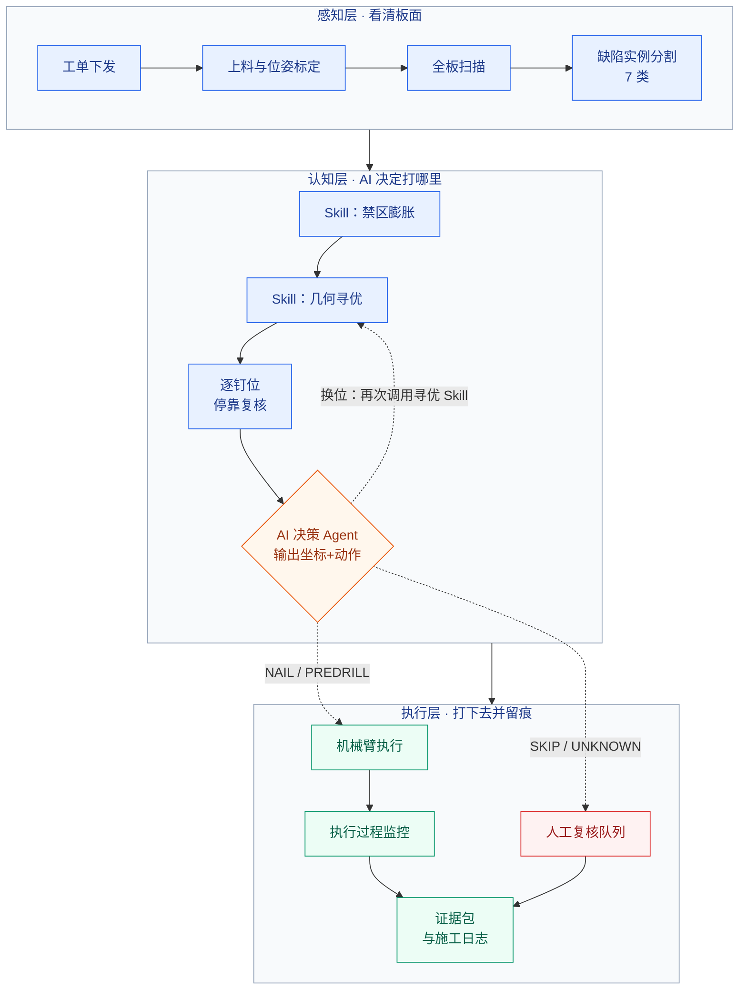
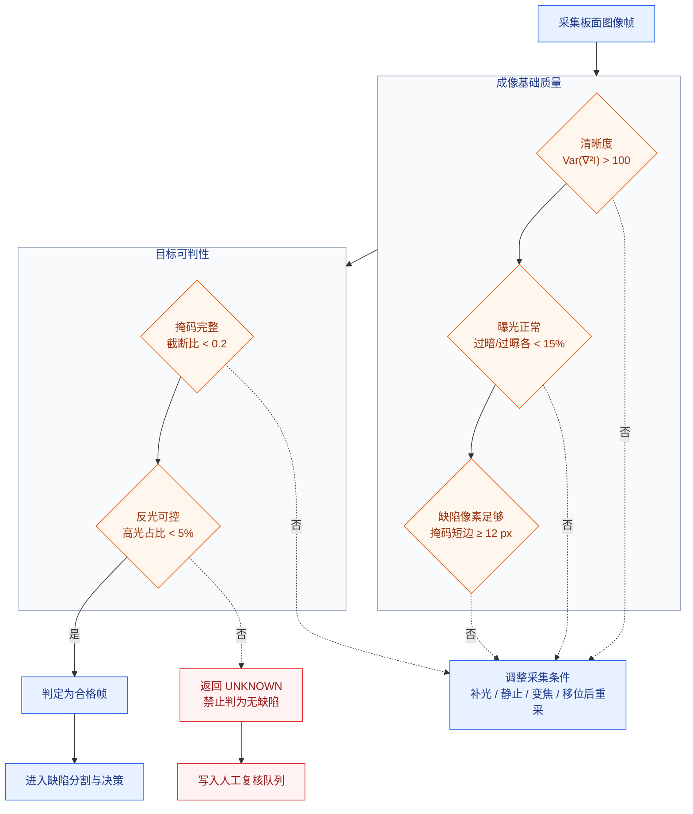

# 预制竹木构件缺陷检测驱动的机械臂智能打钉系统方案

## 1. 方案：缺陷检测驱动的木材智能打钉算法技术方案

缺陷感知 · AI 决策 · 几何 Skill · 机械臂执行

| 项目 | 内容 |
|---|---|
| 作业场景 | 预制竹木构件（Glubam 胶合竹、重组竹、规格材）墙体 / 楼板的钉合装配作业 |
| 质量风险源 | 木节、裂缝、腐朽、虫洞在板面随机分布；既有铁钉钉帽外露或锈蚀。按图纸固定钉位打钉时，钉子可能正落在缺陷或既有铁钉上 |
| 风险后果 | 顺纹劈裂、握钉力不足、钉子断裂或滑移；单钉轴向承载力最低降至 **0.997 kN**（TBKS55 实测，COV **35.8%**），而同埋深最优组可达 **3.415 kN**（TBK55，COV 10.7%）——**承载力离散度超过 3 倍，连接性能不可预测**；返修需拆板，且缺乏钉位级追溯记录 |
| 技术载体 | 六轴工业机械臂 + 面阵工业相机 + 3D 轮廓相机 + 气动钉枪/预钻双工位末端 + 边缘计算单元 + AI 决策 Agent（调用禁区/寻优/规范 Skill）+ 规范知识库（RAG） |
| 现有基础 | 组内 EN 1382 拉拔 / 双剪试验数据（TBK/TBKS/TBKT 系列，5 组 23 件有效试件）；XYLab 控制系统前端 10 模块，几何算法已作为可调用 Skill 接入浏览器端真实运算 |
| 文档版本 | V1.0（首版算法与选型方案） |
| 日期 | 2026-08-24 |

**核心方案**：落钉位置与动作由 **AI 决策 Agent** 给出。视觉模型负责看清板面缺陷；禁区膨胀、几何寻优、规范校核注册为 Agent 可调用的 **Skill**。Agent 对每颗钉输出 **落钉坐标 + 动作**（直接钉合 / 换位 / 跳过；若需控制劈裂，可同时给出预钻工艺）。**坐标必须来自 Skill 返回的确定性可行点，禁止模型自由生成坐标。** 流程上仍分两级：全板扫描后，Agent 先调用 Skill 完成禁区与候选点计算（粗规划）；机械臂随后逐点位移动，在每个钉位上方停留 **0.3–0.5 s** 做局部复检，Agent 结合最新视觉结果再次调用 Skill 终判，确认后才触发钉枪或预钻，并把原图、标注图、调用过的 Skill、规则命中项、置信度与实际执行坐标写入逐钉施工日志。

**方案不是端到端黑盒模型**，而是「视觉感知 + 可调用几何/规范 Skill + AI 决策」的组合。每一颗钉都必须能回答：**相机看见了什么、Agent 调用了哪些 Skill、可行点在哪里、为什么打/为什么挪/为什么跳过**。

---

### 1.1 项目目标与适用边界

#### 1.1.1 本方案解决的问题

| # | 待解决问题 | 现状痛点 | 本方案做法 | 验收指标 |
|---|---|---|---|---|
| P1 | 钉位与缺陷的空间冲突 | 图纸钉位固定，木节/裂缝随机分布，靠工人目视避让，无标准 | 视觉分割 7 类缺陷后，AI 调用禁区膨胀 Skill（10 mm）与几何寻优 Skill（KD-tree / 软代价），在可行点中输出落钉坐标与动作 | 缺陷区落钉率 **0%**；换位钉位偏移量中位数 ≤ 15 mm |
| P2 | 避让决策无规范依据 | 「离木节多远算安全」凭经验，不同班组不一致 | 膨胀半径与预钻阈值由 EN 1382 拉拔数据反算的 κ(d) 折减曲线确定；间距校核直接调用 Eurocode 5 Table 8.2 | 每颗钉的决策均可引用到具体条款号（如 EN1995-8.3.1.2） |
| P3 | 顺纹劈裂 | 重竹/Glubam 顺纹钉入易劈裂，事后不可修 | 基材×纹理硬修正：重竹且顺纹时强制 `NAIL → PREDRILL_THEN_NAIL`，预钻孔径 ≤ 0.8d | 顺纹试钉劈裂率 ≤ 2% |
| P4 | 打在既有铁钉上 | 多层叠合板返工时看不见下层钉，钻头/钉子损坏 | `nail_exposed` / `nail_rusted` 类别 + 安全距 5 mm 硬规则，命中即 SKIP 并挂人工复核 | 钉-钉碰撞 **0** 次 |
| P5 | 多板叠合搭接不足 | T 型节点重合区靠人工放线，搭接不够则钉子只咬一层 | Sutherland–Hodgman 求上下板重合区 → 向内腐蚀 minOverlap/2（30 mm 搭接 → 内缩 15 mm）→ 区外全部置为禁区 | 有效搭接 ≥ 30 mm，重合区外落钉率 0% |
| P6 | 像素坐标到机器人坐标的精度 | 视觉给的位置到了机械臂就偏了 | 张正友内参标定 + 手眼标定 + 板面单应矩阵；全部距离规则在毫米制板面坐标系内计算，**不使用像素距离** | 手眼对齐误差 ≤ **0.5 mm**（当前离线标定 0.32 mm） |
| P7 | 大模型幻觉与不可控 | 直接让大模型自由生成钉位坐标，无法验证、无法复现 | AI 输出坐标 + 动作，但 **xy 必须属于几何寻优 Skill 返回的可行点集合**；规范引用须能反查原文；硬规则 Skill 冲突则强制 SKIP | 坐标 100% 来自 Skill 可行点；引用校验通过率 ≥ 99% |
| P8 | 施工质量无追溯 | 打完就完了，出问题无法定位到哪颗钉 | 逐钉证据包（原图、标注图、决策链、规则命中、置信度、设计/实际坐标、偏移量），导出 JSON / CSV 施工报告 | 每颗钉证据完整率 100% |
| P9 | 「没看清」被误判为「没问题」 | 模糊、遮挡、像素不足时模型仍强行给结论 | 图像质量门控：清晰度/曝光/目标像素/遮挡四项不合格则返回 **UNKNOWN**，触发重采或人工复核，**绝不默认为合格** | UNKNOWN 事件 100% 进入复核队列，无静默放过 |

#### 1.1.2 能力边界定义

- 本系统是**钉位决策与执行设备**，不替代机械臂本体的碰撞检测、安全光栅、急停回路及法定安全装置。
- 首版**不做木材树种识别、不做力学性能反演**；基材（重竹/松木/杉木/胶合板）与纹理方向（顺纹/横纹/斜纹）由工单参数下发。
- 缺陷类别以 7 类为基线（活节、死节、裂缝、腐朽、虫洞、外露钉帽、锈蚀钉帽），具体品类与严重度阈值由甲方工艺文件配置。
- **文中所有距离、时间、力值阈值均为初始建议值**，必须结合实际构件尺寸、钉型、基材密度和试验标定结果签字固化后方可投产。
- **AI 是落钉位置与动作的决策主体**：输出每颗钉的坐标与动作（直接钉合 / 换位 / 跳过，必要时附带预钻工艺）。
- **坐标仍为确定性结果**：必须来自已注册 Skill（禁区膨胀、几何寻优、重合区约束、规范校核）返回的可行点，**禁止模型在可行域外自由指定坐标**。
- 硬规则以 Skill 形式进入决策；Agent 结论若与硬规则冲突，强制降级为 SKIP，不允许「模型说没问题」覆盖安全否决。

---

### 1.2 总体算法架构



逐钉循环：证据包写入施工日志后回到「逐钉位停靠复核」，直至全板钉位处理完毕。

系统按「感知—认知—执行」三层解耦，各层职责与技术手段：

| 层 | 职责 | 技术手段 | 输出 |
|---|---|---|---|
| 感知层 | 看清板面 | 工业相机 + YOLO 实例分割 + 3D 轮廓 + 质量门控 | 缺陷掩码、类别、置信度、板面世界坐标 |
| 认知层 | 决定打不打、打哪里 | **AI 决策 Agent** 调用禁区膨胀 / 几何寻优 / EC5 校核 / RAG 检索等 Skill，输出坐标 + 动作 | 逐钉坐标、动作、执行参数、规则引用、置信度 |
| 执行层 | 打下去并留痕 | Skill 原语 + 状态机 + ROS 2/MoveIt + 数字孪生 | 实际轨迹、力/深度反馈、施工日志 |

---

### 1.3 构件上料与位姿标定

#### 1.3.1 上料定位

- 构件由输送辊道或人工上料至钉合工位，采用**两侧定位挡块 + 单侧气缸压紧**做粗定位，机械重复定位精度目标 ±2 mm。
- 粗定位残余误差由视觉补偿：板面四角设 ArUco/棋盘格靶标（或直接用板边直线拟合），求板面坐标系相对机器人基坐标系的位姿。
- 板边检测采用 Canny + 概率霍夫直线拟合，四边交点得角点；角点残差 > 1.5 mm 时判定上料异常，报警并要求重新上料。

#### 1.3.2 板面坐标系与单应映射

| 步骤 | 算法 | 初始值 / 门限 | 不合格动作 |
|---|---|---|---|
| 相机内参 | 张正友棋盘格标定，求 K 与畸变系数 | 重投影误差 < 0.2 px | 重新标定，固定焦距后锁定镜头 |
| 手眼标定 | Tsai-Lenz / Park-Martin（eye-to-hand），求相机→机器人基座外参 | 对齐误差 ≤ **0.5 mm**（当前离线值 **0.32 mm**） | 增加标定姿态数至 ≥ 15 组重算 |
| 板面单应 | 不少于 4 个板面控制点求像素→板面平面单应矩阵 H | 控制点反算残差 < 0.3 mm | 补采控制点 |
| 尺度校核 | 标准量块或靶标实测 | **0.25 mm/px**（600×400 mm 板对应 2400×1600 px） | 调整工作距离或换镜头 |
| 平面度 | 3D 轮廓相机拟合板面平面 | 局部起翘 < 3 mm | 加压紧点或降级为分区标定 |

缺陷与钉位统一取**掩码质心**（或检测框底边中心）投影到板面坐标系，**所有间距、膨胀、安全距规则均在毫米制板面坐标下计算**，避免透视与像素尺度带来的偏差。

---

### 1.4 图像采集与质量门控

只有合格帧可以进入缺陷终判。**「没看清」必须返回 UNKNOWN，不能直接判为「无缺陷」**——这是本系统最重要的一条安全默认值。

| 质量项 | 算法 | 初始值 | 不合格动作 |
|---|---|---|---|
| 清晰度 | Laplacian 方差 Var(∇²I) | > 100（按镜头标定） | 等待振动衰减后重采 |
| 曝光 | 灰度直方图两端像素占比 | 过暗、过曝各 < 15% | 调整曝光时间 / 开启同轴补光 |
| 目标像素 | 缺陷掩码最小外接框短边 | ≥ 12 px 才做类别终判 | 局部变焦或机械臂靠近复检 |
| 掩码完整度 | 掩码是否被图像边界截断 | 截断比 < 0.2 | 移动视场重采，拼接后判定 |
| 运动模糊 | 相邻帧光流中位数 | 采图前机械臂静止 ≥ 200 ms | 延长静止等待 |
| 板面反光 | 高光区连通域面积占比 | < 5% | 切换偏振片 / 调整光源角度 |



---

### 1.5 缺陷检测、分割与模型部署

#### 1.5.1 缺陷类别定义

| 类别 | 代码 | 严重度分级依据 | 默认动作 | 附加安全距 |
|---|---|---|---|---|
| 活节 | `knot_live` | 直径、是否贯通 | PREDRILL_THEN_NAIL | 10 mm |
| 死节 | `knot_dead` | 是否松动/脱落风险 | RELOCATE | 15 mm |
| 裂缝 | `crack` | 长度、宽度、是否顺纹 | RELOCATE | 10 mm |
| 腐朽 | `decay` | 面积、深度 | **SKIP（硬规则）** | 20 mm |
| 虫洞 | `wormhole` | 密度（单孔/密集） | PREDRILL_THEN_NAIL | 8 mm |
| 外露钉帽 | `nail_exposed` | — | **SKIP（硬规则）** | 5 mm |
| 锈蚀钉帽 | `nail_rusted` | 锈蚀程度 | **SKIP + 人工复核** | 5 mm |

严重度修正规则：`severe` 且原动作为 NAIL 时升为 RELOCATE；`moderate` 且原动作为 NAIL 时升为 PREDRILL_THEN_NAIL。多缺陷同时命中时**取最保守动作**，保守度排序 `SKIP > RELOCATE > PREDRILL_THEN_NAIL > NAIL`。

#### 1.5.2 检测模型选型

| 子模型 | 首选 | 备选 | 任务 |
|---|---|---|---|
| 缺陷实例分割 | **YOLO11s-seg**，TensorRT FP16 | YOLOv8s-seg / RT-DETR-R18 + SAM 精修 | 7 类缺陷掩码、类别、置信度 |
| 既有钉帽检测 | YOLO11n（专用小模型） | 同全景模型多任务头 | 钉帽定位，避免钉-钉碰撞 |
| 木纹方向估计 | Gabor 滤波组 + 主方向直方图 | 轻量回归网络 | 供顺纹/横纹硬修正与 EC5 角度 α |
| 板边与靶标 | Canny + 霍夫 / ArUco | 深度学习角点回归 | 板面坐标系建立 |
| 平面度与厚度 | 3D 轮廓相机点云平面拟合 | 激光位移传感器多点采样 | 搭接校核、Z 向补偿 |

**数据与训练策略**：
- 冷启动用 Kodytek 等公开木材缺陷数据集做预训练（约 2 万张量级）。
- 现场采集**不少于 3000 张**实际构件图像做微调，按基材类型分层采样；缺陷标注采用多边形掩码。
- 类别不均衡（腐朽、锈蚀钉帽样本稀少）用过采样 + Copy-Paste 增强补偿。
- 验收指标：7 类平均 **mAP50 ≥ 0.80**；`decay` / `nail_exposed` / `nail_rusted` 三类**召回率 ≥ 0.95**（漏检代价远高于误检，宁可多报）。
- 部署形态：TensorRT 引擎，单帧推理 ≤ 80 ms @ 2448×2048 分块推理。

#### 1.5.3 置信度处理

- 感知层显示过滤阈值 **0.30**（仅影响可视化，不影响决策）。
- 决策层置信度门槛 **0.60**：低于此值的缺陷判定强制走 SKIP 并写入人工复核队列，**不允许因为「模型不太确定」就当作没有缺陷**。
- 各动作默认置信度基线：直接打钉 0.92、预钻 0.85、换位 0.82、跳过 0.90、AI 融合决策 0.78。

---

本节算法以 `skill_build_cost_map` / `skill_dilate_forbidden` 注册给 AI 决策 Agent。Agent 在全板粗规划与逐钉终判时调用，自身不重新发明禁区边界。

| 参数 | 初始值 | 说明 |
|---|---|---|
| 栅格单元 `cellSize` | **2 mm** | 600×400 板 → 300×200 格；可调 1–5 mm |
| 缺陷栅格化 | 包围盒内遍历 + 射线法判点在多边形内 | 命中则置 `forbidden = 1` |
| 板缘余量 `markEdgeMargin` | 由 EC5 `a4,c` 计算 | 板边一圈直接标禁区 |
| 装配约束 | 重合区外全部置禁区 | 多板叠合时启用 |

#### 1.6.2 圆形结构元膨胀

采用**圆形结构元素的 Minkowski 膨胀**（等价 OpenCV `MORPH_ELLIPSE`），栅格半径 `r = round(radiusMm / cellSize)`，预生成满足 `dx² + dy² ≤ r²` 的核偏移表。

膨胀后栅格分三态，便于可视化与决策分级：

| 值 | 含义 | 决策含义 |
|---|---|---|
| 0 | 可行区 | 允许落钉 |
| 1 | 缓冲区（膨胀新增） | 落钉需降级为预钻或换位 |
| 2 | 核心区（原始缺陷） | 绝对禁止落钉 |

**膨胀半径 `dilationRadius` 初始值 10 mm**，来源为组内拉拔试验反算的 κ(d) 折减曲线（见 3.1 节），非经验拍定。该值是本系统最关键的可标定参数，投产前须按实际钉型与基材重新标定。

#### 1.6.3 软代价图（可选模式）

硬禁区模式（`costMode = 'hard'`）下缺陷区为 0/1 二值；软代价模式下按高斯衰减建立连续风险场：

```
单缺陷：C_k(p) = conf_k · exp( -d² / (2σ²) )
多缺陷叠加后截断至 [0, 1]
σ 初始值 15 mm
```

寻优目标函数：

```
p* = argmin [ α · d(p, p₀) + β · C(p) ],  p ∈ 可行域
α = 1.0（偏移距离权重）
β = 30（风险代价权重）
```

软模式适用于缺陷密集、硬禁区导致无解的板面；硬模式默认启用，逻辑更易审计。

---

### 1.7 钉位寻优 Skill（供 AI 调用）

几何寻优不替代 AI 决策，而是 Agent 的工具：`skill_find_optimal_position`。Agent 需要换位或确认原位是否可打时调用本 Skill，**从返回的可行点中选取落钉坐标**。

#### 1.7.1 全局最近合规点搜索

- 收集所有 `forbidden = 0` 的栅格中心构建**二维 KD-tree**（轴交替 x/y），构建复杂度 O(N log N)，单次最近邻查询 O(log N)。
- 对每个设计钉位 p₀：若不在禁区则原位保留（`status = direct`）；若在禁区则查询最近可行点。
- 分割超平面剪枝条件 `diff² < bestDist`，避免全域暴力搜索；300×200 栅格下单钉寻优耗时 < 1 ms。
- 偏移量 > **0.5 mm** 判定为换位（`status = relocated`），记录设计坐标与实际坐标之差。

#### 1.7.2 问题建模

该问题本质是**带禁区的设施选址问题（Facility Location with Forbidden Regions, FLP-FR）**：在连续可行域内为每个需求点找最小代价服务位置，同时满足最小间距约束（EC5）与全局连接性能约束。当前实现为逐点贪心最近邻，后续可升级为带间距约束的整体优化（如最小代价二分图匹配或列生成）。

#### 1.7.3 局部上下文构建

每个钉位取半径 **20 mm** 内的缺陷作为决策上下文（`NailContext`），包含：缺陷类别、严重度、置信度、质心距离、是否在缓冲/核心区、最近既有铁钉距离、基材、纹理方向。该上下文连同 Skill 返回的候选点一并交给 AI 决策 Agent，保证同一输入下决策可复现。

---

### 1.8 规范约束与 Eurocode 5 间距校核

#### 1.8.1 最小间距计算（EN 1995-1-1 Table 8.2）

输入：钉径 d（mm）、特征密度 ρk（kg/m³）、纹理角 α（0° = 顺纹）、是否预钻。

| 条件 | a₁（顺纹间距） | a₂（横纹间距） | a₃,t（受荷端距） | a₃,c（无荷端距） | a₄,t（受荷边距） | a₄,c（无荷边距） |
|---|---|---|---|---|---|---|
| 预钻孔 | (4+\|cosα\|)·d | 3d | (7+5cosα)·d | 7d | (3+2sinα)·d | 3d |
| 未预钻，ρk ≤ 420 | (5+7\|cosα\|)·d | 5d | (10+5cosα)·d | 10d | (5+2sinα)·d | 5d |
| 未预钻，420 < ρk ≤ 500 | (7+8\|cosα\|)·d | 7d | (15+5cosα)·d | 15d | (7+2sinα)·d | 7d |

推荐最小边距 `minEdge = max(a₄,c, a₄,t)`，直接用于 `markEdgeMargin` 板缘禁区宽度。

**嵌入强度**（无预钻）：`f_h,k = 0.082 · (1 − 0.01d) · ρk` [MPa]
**钢钉轴向拔出特征强度**：`f_ax,k = 20×10⁻⁶ · ρk²` [MPa]

计算器默认工况：d = 3.1 mm，ρk = 410 kg/m³，α = 0°，未预钻。

#### 1.8.2 硬规则条目

| 规则 ID | 来源 | 优先级 | 内容 |
|---|---|---|---|
| EN1995-8.3.1.2 | EN 1995-1-1 p.62 | hard | Table 8.2 最小间距，超限即不合规 |
| EN1995-8.3.1.1 | EN 1995-1-1 p.61 | hard | ρk > 500 或 d ≥ 6 mm 应预钻；预钻孔径 ≤ **0.8d** |
| EN1382-6.2 | EN 1382 p.8 | high | 拔出试验破坏时间 (300 ± 120) s，即 180–420 s，恒定位移速率 |
| EN26891-7.1 | EN 26891 p.5 | high | 加载程序：40%F_est 保持 30 s → 卸至 10% 保持 30 s → 0.2F_est/min 至破坏；K_ser = 0.4·F_est / v_i,mod |
| EN384-5 | EN 384 p.11 | medium | ρk 取 5% 分位值，含水率修正至 12% |
| EXP-knot-dilation | 组内试验 | high | 木节膨胀安全半径 **10 mm** |
| EXP-bamboo-predrill | 组内试验 | medium | 重竹顺纹强制预钻，孔径约 0.8d |

#### 1.8.3 规范知识库与 RAG

- 已入库规范 6 部：EN 1995-1-1（128 chunks）、EN 1382（34）、EN 1380（28）、EN 26891（22）、EN 384（41）、GB/T 50005（96）。
- 切分策略：按条款切分（`by_clause`），`max_tokens = 400`，`overlap = 50`。
- 检索：向量检索 Top-K = 5，hard 优先级规则加权 +0.3。
- **防幻觉双校验**（约束 AI 决策，而不是把 AI 降级为只写理由）：
  1. `verify_citation`：Agent 引用的条款号必须能在知识库中反查到原文，否则整条决策作废。
  2. `check_feasible_xy`：Agent 输出的坐标必须落在寻优 Skill 返回的可行点集合内，否则拒绝执行。
  3. `check_hard_rule_conflict`：Agent 建议若与任一 hard 规则 Skill 冲突，强制降级为 SKIP。
- 校验失败一律降级，**不允许「模型说没问题」覆盖硬规则，也不允许在可行域外指定坐标**。

---

### 1.9 AI 决策：坐标、动作与证据链

#### 1.9.1 决策主体与 Skill 工具箱

**决策主体是 AI Agent**，不是规则流水线的最后一层旁路。Agent 观察板面状态与钉位上下文，按需调用 Skill，输出 `{xy, action, params, cited_rules, confidence}`。

| Skill | 作用 | 返回给 Agent 的内容 |
|---|---|---|
| `skill_dilate_forbidden` | 缺陷禁区膨胀 | 三态栅格（可行 / 缓冲 / 核心） |
| `skill_find_optimal_position` | 几何寻优 | 原位或最近/最优可行点，确定性坐标 |
| `skill_check_overlap` | 装配重合区 | 区外则建议 SKIP |
| `skill_check_ec5` | Table 8.2 间距/边距 | 合规或违规项 |
| `skill_check_hard_rules` | 既有铁钉、腐朽核心区等 | HIT / MISS |
| `skill_retrieve_rules` | 规范 RAG | Top-K 条款与原文 |

**关键约束**：Agent **可以**输出落钉坐标和动作；坐标 **必须**是某个寻优/校核 Skill 返回过的点。Agent 不得在可行域外自造 xy。硬规则 Skill 命中时动作只能是 SKIP。

**基材×纹理**：基材含「竹」且为顺纹时，Agent 在选择直接钉合前应调用预钻工艺（`PREDRILL_THEN_NAIL`），并追加风险标记「重竹顺纹劈裂风险」。该条由硬规则 Skill 注入，Agent 不可绕过。

#### 1.9.2 四类动作与执行参数

| 动作 | 触发条件 | 执行参数（初值） | 严重度 |
|---|---|---|---|
| `NAIL` | 无缺陷、无冲突、间距合规 | 插入角 0°，打钉力 **800 N** | — |
| `PREDRILL_THEN_NAIL` | 活节/虫洞邻近；重竹顺纹；缓冲区落钉 | 预钻深度 **4.4 mm**（≈0.8d, d=5.5），打钉力 **600 N** | MEDIUM |
| `RELOCATE` | 死节/裂缝邻近；设计点在禁区且有可行点 | 移至最近合规点，参数同 NAIL | MEDIUM |
| `SKIP` | 腐朽、既有铁钉、重合区外、置信度 < 0.60、无可行点 | 不执行，挂人工复核 | HIGH |

#### 1.9.3 融合原则

对多条可解释规则在同一钉位上做**并集**，再按严重度取最高级：

```
NAIL_BLOCKED =
    ( outside_overlap_region
      OR existing_nail_conflict
      OR decay_core_region
      OR ec5_spacing_violation
      OR confidence < CONF_THRESHOLD
      OR view_valid == false )
```

| 门控 | 作用 | 不满足时 |
|---|---|---|
| `work_state == ACTIVE` | 仅在钉合工序进行中做决策 | 本轮不判定，等待工序信号 |
| `view_valid` | 图像质量门控通过 | 返回 UNKNOWN，重采或人工复核 |
| `overlap_valid` | 有效搭接 ≥ 30 mm | 整板报警，不允许开钉 |
| 并集 | 任一命中即阻断 | 全部未命中则放行 |

单钉结论三态：**PASS / BLOCKED / UNKNOWN**。UNKNOWN 一律进入人工复核队列，不静默放过。

#### 1.9.4 逐钉证据包

| 字段 | 内容 |
|---|---|
| `nail_id` | 钉位编号，与图纸钉位表关联 |
| `board_id` / `site_id` | 构件编号、工位编号 |
| `design_xy` / `final_xy` | 设计坐标、实际执行坐标（板面坐标系，mm） |
| `offset` | 偏移量 mm；> 0.5 mm 标记为换位 |
| `action` | NAIL / PREDRILL_THEN_NAIL / RELOCATE / SKIP |
| `rule_hit` | 命中的规范条款与经验规则列表 |
| `cited_rules` | 条款号 + 原文片段（经 `verify_citation` 校验） |
| `confidence` | 缺陷置信度、决策置信度 |
| `evidence` | 原图、标注图（掩码+禁区+钉位叠加）、局部复检图 |
| `quality` | 清晰度、曝光、掩码完整度、view_valid |
| `exec_feedback` | 实际打钉力/电流曲线、预钻深度、Z 向位移 |
| `stage` | 决策来源（agent + 调用过的 skill 列表） |
| `skills_called` | 本钉调用过的 Skill 名称与返回摘要 |
| `risk_flags` | 风险标记，含「需人工复核」时进入队列 |
| `timestamps` | 检测、决策、执行、上传时间 |

导出格式：JSON（完整证据链）+ CSV（`nailId, action, designX/Y, finalX/Y, offset, compliant, reason`），经 MQTT / HTTPS 上传 MES，支持断网补传与同事件去重。

---

### 1.10 机械臂执行与 Skill 原语

#### 1.10.1 Skill 原语表

| Skill | 分组 | 安全约束 |
|---|---|---|
| `skill_detect_defects` | 感知 | — |
| `skill_scan_existing_nails` | 感知 | — |
| `skill_dilate_forbidden` | 决策 | 膨胀半径须为标定值 |
| `skill_build_cost_map` | 决策 | — |
| `skill_find_optimal_position` | 决策 | 返回点必须在可行域内 |
| `skill_check_overlap` | 决策 | 区外只能建议 SKIP |
| `skill_check_ec5` | 决策 | Table 8.2 违规不得放行 |
| `skill_check_hard_rules` | 决策 | 硬规则命中只能 SKIP |
| `skill_retrieve_rules` | 决策 | 条款须能反查原文 |
| `skill_move_to` | 执行 | 碰撞检测 + 工作空间边界校验 |
| `skill_predrill` | 执行 | 钻头就位确认 + 转速到达 |
| `skill_nail` | 执行 | **须先通过 `validate_decision`** |
| `skill_retract` | 执行 | 退回安全高度后才允许下一次移动 |
| `skill_skip` | 执行 | 写入复核队列 |
| `skill_emergency_stop` | 安全 | **最高优先级，可中断任何 Skill** |
| `skill_log_decision` | 记录 | — |
| `skill_generate_report` | 记录 | JSON / PDF |

#### 1.10.2 动作序列

| 动作 | Skill 序列 |
|---|---|
| NAIL | `move_to → nail → retract` |
| PREDRILL_THEN_NAIL | `move_to → predrill → nail → retract` |
| RELOCATE | `move_to(relocated_xy) → nail → retract` |
| SKIP | `skip → flag_for_human` |

#### 1.10.3 状态机

机器人状态：`HOME / SCANNING / MOVING / NAILING / PREDRILL / ESTOP`
任务状态：`INIT / IDLE / TASK / SWITCHING / FAULT`

任何 Skill 执行前校验：决策已放行、目标点在工作空间内、无碰撞、安全回路闭合。任一项失败即转 FAULT 并停止取料。

#### 1.10.4 执行过程监控

| 监控项 | 传感手段 | 判据（初值） | 异常动作 |
|---|---|---|---|
| 钉入深度 | 钉枪 Z 向位移传感器 | 目标深度 ±1.5 mm | 标记不合格钉，报警 |
| 打钉力 | 气压传感器 + 电流监测 | 800 N ± 15% | 复检气压与钉仓 |
| 预钻深度 | 主轴 Z 轴伺服反馈 | 4.4 mm ± 0.5 mm | 重新预钻或降级 SKIP |
| 空钉/卡钉 | 钉仓传感器 + 声学检测 | 无钉信号 | 暂停，补钉后续打 |
| 劈裂 | 打钉后局部复检图像 | 裂缝新增判定 | 记录并报警 |

---

### 1.11 完整在线推理伪代码

```python
# ============ 阶段一：上料与标定（每块板一次）============
board = wait_for_board_loaded()
pose  = locate_board(camera_2d, camera_3d)        # ArUco / 板边拟合
if pose.residual > 1.5:                            # mm
    raise_alarm("LOAD_MISALIGN"); reload_board()

H = solve_homography(control_points)               # 像素 → 板面 mm
assert hand_eye.error <= 0.5                       # mm

# ============ 阶段二：全板粗规划 ============
frames = scan_board(board)                         # 分块采图 + 拼接
if not quality_gate(frames):                       # 1.4 节质量门控
    return UNKNOWN("IMAGE_QUALITY")                # 绝不默认为无缺陷

defects = yolo_seg(frames)                         # 7 类实例分割
defects = [d for d in defects if d.conf >= CONF_FILTER]
defects = project_to_board(defects, H)             # 板面 mm 坐标

grid = create_grid(board.w, board.h, CELL_SIZE)    # 2 mm
grid = rasterize_defects(grid, defects)            # forbidden = 1
grid = dilate_circular(grid, DILATION_RADIUS)      # 10 mm，三态分类
grid = mark_edge_margin(grid, ec5_min_edge(d, rho_k, alpha))

if board.is_multilayer:                            # 多板叠合 T 型节点
    region = polygon_intersection(upper.poly, lower.poly)   # Sutherland-Hodgman
    if max_inscribed_dimension(region) < MIN_OVERLAP:       # 30 mm
        raise_alarm("INSUFFICIENT_OVERLAP"); return
    region = erode_polygon(region, MIN_OVERLAP / 2)         # 内缩 15 mm
    grid   = mark_outside_polygon(grid, region)

if COST_MODE == "soft":
    cost = build_soft_cost(defects, SIGMA)         # 15 mm 高斯

feasible = collect_feasible_points(grid)           # forbidden == 0
kdtree   = KDTree(feasible)

# ============ 阶段三：逐钉位停靠复核 · AI 决策与执行 ============
for nail in board.design_nails:
    # --- Agent 调用几何 Skill，坐标为确定性结果 ---
    cand = agent.call("skill_find_optimal_position", nail.xy, grid, cost)
    if cand.xy is None:
        log(nail, SKIP, "NO_FEASIBLE_POINT"); continue

    # --- 停靠复核：局部高分辨复检 ---
    robot.execute("skill_move_to", above(cand.xy), z=SAFE_Z)
    robot.dwell(0.3)                               # 0.3–0.5 s 稳定
    local = capture_local(cand.xy, fov=40)          # mm
    if not quality_gate(local):
        log(nail, UNKNOWN, "LOCAL_VIEW_INVALID"); enqueue_review(nail); continue

    ctx = build_context(cand.xy, defects + yolo_seg(local),
                        radius=20,
                        substrate=board.substrate,
                        grain=board.grain)

    # --- AI 决策：输出坐标 + 动作；坐标必须来自 Skill 可行点 ---
    dec = agent.decide(ctx, candidates=cand.feasible_set)
    #   可调用：dilate / find_optimal / check_overlap / check_ec5 /
    #           check_hard_rules / retrieve_rules
    if dec.xy not in cand.feasible_set:            # 禁止自由生成坐标
        dec = downgrade_to_skip(dec, "XY_NOT_FROM_SKILL")
    if not verify_citation(dec.cited_rules):
        dec = downgrade_to_skip(dec, "CITATION_FAILED")
    if check_hard_rule_conflict(dec):
        dec = downgrade_to_skip(dec, "HARD_RULE_CONFLICT")
    if dec.confidence < CONF_THRESHOLD:            # 0.60
        dec = downgrade_to_skip(dec, "LOW_CONFIDENCE")

    # --- 执行 ---
    if dec.action == "SKIP":
        robot.execute("skill_skip"); enqueue_review(nail)
    else:
        if not validate_decision(dec, dec.xy):
            robot.fault("VALIDATE_FAILED"); break
        for skill in ACTION_SEQ[dec.action]:
            fb = robot.execute(skill, dec.xy, dec.params)
            if not fb.ok:
                robot.fault(skill); break
        verify_result = inspect_after_nail(dec.xy)

    log_evidence(nail, dec.xy, dec, local, verify_result)

robot.execute("skill_generate_report")             # JSON + CSV → MES
```

---

## 2. 生产落地技术选型

> 以下为**投产级选型建议**，含首选与备选。所有型号需在样机阶段做工艺验证与现场复核后固化。

### 2.1 视觉采集

| 项目 | 首选选型 | 备选 | 选型依据 |
|---|---|---|---|
| 2D 面阵相机 | **Hikrobot MV-CS050-10GC**（5 MP，2448×2048，GigE，2/3″ IMX264，3.45 μm 像元） | Basler acA2440-35um（USB3，同分辨率） | 0.25 mm/px × 2448 px = 612 mm，单次覆盖 600 mm 板宽；GigE 便于长距离与多机扩展 |
| 镜头 | **C 口 16 mm 定焦，F2.8，5MP 级低畸变工业镜头**（如 Computar M1614-MP2） | 12 mm（工作距离更短，约 0.88 m） | 传感器 8.45 mm 宽 / 视场 612 mm → 放大率 0.0138，16 mm 镜头对应工作距离约 1.17 m；需选低畸变型号并由标定残差验证 |
| 光源 | **条形白光 LED（2 组对射，可调亮度）+ 线性偏振片** | 环形无影光源 / 同轴光 | 木纹低对比 + 板面反光是主要干扰，偏振组合抑制高光 |
| 3D 轮廓 | **Mech-Eye LSR L**（激光结构光，大视场远距型） | Photoneo MotionCam-3D / 单线激光位移传感器阵列 | 用于板面平面度、厚度与搭接校核；实际点云精度须现场实测，要求优于 Z 向补偿需求（约 0.5 mm） |
| 局部复检 | 复用主相机 + 机械臂靠近（省一台相机） | 末端小视场相机（如 MV-CA013-A0UM） | 停靠复核需 ≥ 12 px 缺陷短边，靠近至 400 mm 即可满足 |
| 标定件 | 陶瓷棋盘格标定板（0.01 mm 级） + ArUco 板面靶标 | — | 内参与手眼标定精度直接决定 0.5 mm 门限能否达成 |

### 2.2 机械臂与末端执行器

| 项目 | 首选选型 | 备选 | 选型依据 |
|---|---|---|---|
| 机械臂 | **KUKA KR 210 R2700**（负载 210 kg，臂展 2696 mm，重复定位 ±0.06 mm） | KUKA KR 60-3（负载 60 kg，臂展 2033 mm，成本更低） | 墙段构件尺寸大，需大臂展；打钉反冲力与末端组合重量需要余量。若仅做单板试验，KR 60-3 足够 |
| 控制柜 | **KR C4 / KR C5**，含 SafeOperation 安全选项 | — | 需 RSI 或 EthernetKRL 选项包才能对接 ROS 2 |
| 钉枪 | **气动条形钉枪，MAX / Senco 工业型**，配电控气阀 | 电动钉枪（无气源场合） | 竹木钉合以气动为主，冲击力稳定、维护简单；须选可外部触发型号 |
| 预钻主轴 | **气动或电主轴，ER11 夹头，转速 10000–20000 rpm，功率 ≥ 750 W** | 高速直流主轴 + 减速器 | 预钻孔径 ≤ 0.8d（约 2.5–4.4 mm），小孔径高转速 |
| 双工位切换 | **末端集成钉枪 + 主轴双工位支架**（无需换刀） | Schunk / ATI 快换盘 | 双工位省去换刀时间（单钉节拍要求高）；快换方案更灵活但增加 1–2 s |
| Z 向浮动与测距 | **气缸压紧 + 直线位移传感器（量程 50 mm，精度 0.05 mm）** | 激光位移传感器（Keyence IL 系列） | 钉入深度与预钻深度闭环的核心反馈 |
| 力监测 | **气压传感器 + 主轴电流监测**（低成本方案） | ATI Axia80 六维力传感器 | 打钉是冲击工况，六维力传感器易过载损坏；工程上以气压+电流+位移三路间接监测更可靠 |
| 压紧机构 | **气缸压板（2 点）+ 定位挡块** | 真空吸附台 | 打钉反冲会顶起板件，必须机械压紧 |

### 2.3 控制、通信与安全

| 项目 | 首选选型 | 备选 | 选型依据 |
|---|---|---|---|
| 机器人通信 | **KUKA RSI（Robot Sensor Interface）+ `kuka_rsi_driver`（ROS 2）**，实时位姿下发 4 ms 周期 | EthernetKRL（非实时，指令级）；KUKA.PLC mxAutomation | RSI 支持连续轨迹修正；若只需点位运动，EthernetKRL 更简单稳定 |
| 运动规划 | **MoveIt 2**（OMPL + 自定义笛卡尔插值） | 直接下发关节/笛卡尔点位（不用 MoveIt） | 打钉多为点位 + 直线插补，MoveIt 主要用于避障与可视化 |
| I/O 与气阀 | **Beckhoff EtherCAT（EK1100 + EL2008 数字输出 + EL3054 模拟输入）** | 机器人本体 I/O + Profinet | 钉枪触发、气阀、传感器采集统一到 EtherCAT，微秒级同步 |
| 上位通信 | **ROS 2 Humble DDS（内部）+ MQTT / HTTPS（对 MES）** | OPC UA（对接工厂 SCADA） | 内部低延迟用 DDS，对外用 MQTT 便于断网补传与去重 |
| 安全 PLC | **Pilz PNOZmulti 2** 或 Siemens S7-1500F | — | 打钉工位属高危，急停/光栅必须走安全回路，不能由 ROS 软件承担 |
| 安全防护 | **SICK deTec4 安全光幕 + 围栏 + 安全门锁 + 双手启动** | 安全激光扫描仪（SICK microScan3） | 钉枪伤害风险高，须物理隔离 + 光幕联锁 |
| 急停 | 机器人急停 + 工位急停 + 气源快排阀 | — | 急停时必须同步切断气源，防止残压误击发 |

### 2.4 计算与部署

| 项目 | 首选选型 | 备选 | 选型依据 |
|---|---|---|---|
| 边缘计算 | **工业 PC + NVIDIA RTX 4000 Ada SFF（20 GB）**，Ubuntu 22.04 | NVIDIA Jetson AGX Orin 64 GB（低功耗方案） | 2448×2048 分块推理 + TensorRT 需要显存余量；固定工位无功耗约束，IPC 维护更方便 |
| 实时性 | **PREEMPT_RT 内核**（RSI 4 ms 周期要求） | 独立实时控制器 | ROS 2 + RSI 实时通信必须打 RT 补丁 |
| 推理框架 | **TensorRT 8.6（FP16）** | ONNX Runtime GPU / OpenVINO | 单帧 ≤ 80 ms 目标，TensorRT 提速最明显 |
| 模型训练 | PyTorch 2.x + Ultralytics（YOLO11-seg） | MMDetection | 生态成熟，导出 TensorRT 链路完整 |
| 向量库 | **Chroma**（规范知识库，约 350 chunks 量级） | Milvus（大规模场景） | 数据量小，Chroma 部署简单、可嵌入进程 |
| 嵌入模型 | **BAAI/bge-m3**（中英文规范混合检索） | bge-large-zh-v1.5 | 规范文本中英混排，m3 多语言表现更好 |
| LLM / 决策模型 | **本地部署 Qwen2.5-14B-Instruct（vLLM）作为 AI 决策 Agent** | 云端 API（有网且允许时） | Agent 输出坐标 + 动作；坐标必须来自 Skill 可行点。产线建议本地部署，避免网络抖动阻塞节拍 |
| 数据库 | **PostgreSQL**（施工日志与证据索引）+ MinIO（图像/视频对象存储） | SQLite + 本地文件（小规模） | 逐钉证据包体量大，需对象存储 |
| 数字孪生 | **RoboDK**（快速验证，1–2 天） | ROS 2 + Gazebo + RViz2（4–6 周，可做完整仿真） | 前期用 RoboDK 快速验证节拍与可达性，后期迁 Gazebo 做闭环仿真 |
| 前端 | React 18 + TypeScript + Vite 5 + Zustand + Canvas 2D | — | 已实现，10 模块可交互 |
| 后端 | Python FastAPI + Uvicorn | — | 已搭桩，`/api/detect`、`/api/rules/search`、`/api/decide` 待接实模型 |

### 2.5 关键设备 BOM 概览

| 类别 | 设备 | 数量 | 关键指标 |
|---|---|---|---|
| 机械 | KUKA KR 210 R2700 + KR C4 | 1 | 210 kg / 2696 mm / ±0.06 mm |
| 机械 | 气动钉枪（可外部触发） | 1 | 打钉力 600–800 N 可调 |
| 机械 | 电主轴 + ER11 | 1 | ≥ 750 W，10000–20000 rpm |
| 机械 | 气缸压板 + 定位挡块 | 2 + 2 | 粗定位 ±2 mm |
| 视觉 | Hikrobot MV-CS050-10GC + 16 mm 镜头 | 1 | 5 MP，0.25 mm/px |
| 视觉 | Mech-Eye LSR L | 1 | 大视场结构光，精度现场实测 |
| 视觉 | 条形 LED + 偏振片 | 2 组 | 可调亮度 |
| 传感 | 直线位移传感器 | 2 | 量程 50 mm，精度 0.05 mm |
| 传感 | 气压传感器 | 2 | 0–1 MPa，模拟输出 |
| 控制 | Beckhoff EK1100 + EL2008 + EL3054 | 1 套 | EtherCAT |
| 控制 | Pilz PNOZmulti 2 | 1 | SIL 3 / PL e |
| 安全 | SICK deTec4 光幕 + 围栏 + 门锁 | 1 套 | 分辨率 30 mm |
| 计算 | 工业 PC + RTX 4000 Ada SFF | 1 | 20 GB 显存，PREEMPT_RT |

---

## 3. 试验数据到决策参数的映射

本系统所有安全距离与预钻阈值**不是拍定的经验值**，而是由组内 EN 1382 拉拔与双剪试验数据反算得到。这是方案区别于「纯 AI 视觉避让」的关键。

### 3.1 拉拔试验统计结果（表 2-3）

| 试件组 | 埋深 (mm) | n | 强度均值 (kN) | 强度 COV | 刚度均值 (kN/mm) | 刚度 COV | 能量均值 (kN·mm) | 能量 COV |
|---|---|---|---|---|---|---|---|---|
| TBK30 | 30 | 6 | 1.482 | 15.5% | 0.758 | 69.9% | 1.575 | 35.0% |
| TBK45 | 45 | 5 | 1.944 | 21.4% | 0.767 | 21.3% | 2.818 | 39.7% |
| TBK55 | 55 | 3 | **3.415** | 10.7% | 1.874 | 8.1% | 4.325 | 11.2% |
| TBKS55 | 55 | 4 | **0.997** | 35.8% | 0.488 | 27.5% | 4.356 | 65.7% |
| TBKT55 | 55 | 5 | 2.302 | 6.0% | 0.818 | 19.3% | **11.704** | 4.0% |

指标计算方法：强度取峰值荷载；刚度取峰值 20%–60% 段线性拟合斜率；能量取 0.8×峰值后截断的荷载-位移积分。剔除试件：TBK3007、TBK4501、TBK5502、TBKS5504（钉子断裂或滑落）。

### 3.2 数据结论与参数映射

| 试验发现 | 数值证据 | 映射到的系统参数 |
|---|---|---|
| 埋深显著影响握钉力 | TBK 30→45→55 mm：1.48 → 1.94 → 3.42 kN | 钉入深度监控目标值与公差（±1.5 mm）；深度不足直接判不合格钉 |
| 同埋深下组别差异达 3.4 倍 | TBK55 3.415 vs TBKS55 0.997 kN | 证明「打在哪里」比「打多深」影响更大 → 支撑禁区膨胀的必要性 |
| 低性能组变异度最大 | TBKS55 强度 COV 35.8%，刚度 COV 27.5% | 对应基材/位置条件在决策矩阵中取更保守动作（RELOCATE 而非 PREDRILL） |
| 延性最优组能量高且极稳定 | TBKT55 能量 11.704 kN·mm，COV 仅 4.0% | 作为工艺目标工况，反推推荐预钻策略 |
| κ(d) 折减曲线 | 由钉-节距 d 与承载力折减关系拟合 | **膨胀半径 10 mm** = κ(d) ≥ 0.9（折减 ≤ 10%）对应的最小 d*，再乘安全系数 1.2–1.5 |

### 3.3 待补充的标定试验

| 试验 | 目的 | 优先级 |
|---|---|---|
| 钉-节距梯度试验（d = 0/5/10/15/20/30 mm） | 直接测定 κ(d) 曲线，固化膨胀半径 | 高 |
| 预钻 vs 未预钻对照（重竹顺纹） | 量化预钻对劈裂率与承载力的影响，固化预钻触发阈值 | 高 |
| 打钉力梯度试验（600 / 700 / 800 N） | 固化打钉力初值与公差 | 中 |
| 竹钉 vs 钢钉对照 | 判断是否需要分别建立决策矩阵 | 中 |

---

## 4. 分期实施与验收指标

| 阶段 | 时间 | 交付内容 | 验收指标 |
|---|---|---|---|
| P1 感知与标定 | 2026 Q3 | YOLO11s-seg 真机部署、相机与手眼标定、质量门控 | 7 类 mAP50 ≥ 0.80；三类高危缺陷召回 ≥ 0.95；手眼误差 ≤ 0.5 mm；单帧推理 ≤ 80 ms |
| P2 规范决策 | 2026 Q4 | 规范知识库、RAG、AI 决策 Agent 与 Skill 工具箱联调、可行点约束与引用校验 | 坐标 100% 来自 Skill 可行点；决策可追溯到条款；单钉决策 ≤ 200 ms |
| P3 单板闭环 | 2027 H1 上 | 机械臂 Skill 原语、ROS 2/RSI 打通、单板试钉 | 缺陷区落钉率 0%；钉-钉碰撞 0 次；单钉节拍 ≤ 8 s；深度合格率 ≥ 95% |
| P4 墙段验证 | 2027 H1 下 | 多板叠合、T 型节点、墙段连续作业 | 有效搭接 ≥ 30 mm 达标率 100%；连续 200 钉无人工干预；劈裂率 ≤ 2% |
| P5 产线交付 | 2027 H2 | 安全回路、MES 对接、施工报告、性能对照 | 证据完整率 100%；与人工组对照的承载力 COV 下降 ≥ 30% |

---

## 5. 待标定项与开放问题

**必须现场标定后固化的参数**

| 参数 | 当前初值 | 标定依据 |
|---|---|---|
| 膨胀半径 `dilationRadius` | 10 mm | κ(d) 梯度试验 |
| 栅格单元 `cellSize` | 2 mm | 精度与算力权衡，实测寻优耗时 |
| 铁钉安全距 `nailSafeDist` | 5 mm | 钉帽尺寸 + 钻头偏摆实测 |
| 决策置信度门槛 `confThreshold` | 0.60 | 模型 PR 曲线 + 漏检代价评估 |
| 软代价参数 α / β / σ | 1.0 / 30 / 15 mm | 缺陷密集板面的解可行性试验 |
| 打钉力 / 预钻深度 | 800 N / 4.4 mm | 打钉力梯度试验 + 0.8d 规范约束 |
| 最小搭接 `minOverlap` | 30 mm | 节点承载力试验与图纸要求 |
| 换位判定阈值 | offset > 0.5 mm | 机械臂重复定位精度 + 标定误差合成 |

**开放问题（需课题组决策）**

1. 重竹钉与钢钉是否建立**两套独立决策矩阵**？两者劈裂机理与预钻需求差异明显。
2. 预钻触发阈值如何与拉拔数据定量挂钩？目前是「基材含竹且顺纹」的定性规则，能否改为按 ρk 与 κ(d) 的连续判据？
3. 真机打钉力控指标如何设定？气动冲击工况下是否需要引入闭环力控，或维持「气压+位移+电流」间接监控即可？
4. 钉位寻优是否需要从逐点贪心升级为**带 EC5 间距约束的全局优化**？在缺陷密集板面上贪心解可能违反 a₁/a₂ 间距。
5. 产线节拍紧张时，AI Agent 是否允许降级为「Skill 直出坐标 + 规则动作」、大模型只做事后审计？降级后仍须保持坐标来自可行点集合。

---

*文档版本 V1.0 | 2026-08-24 | XYLab · 缺陷检测驱动的木材打钉系统*
